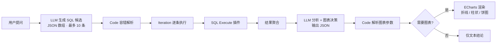
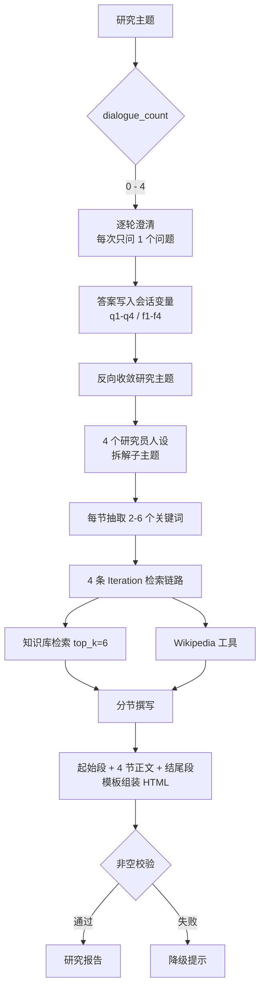
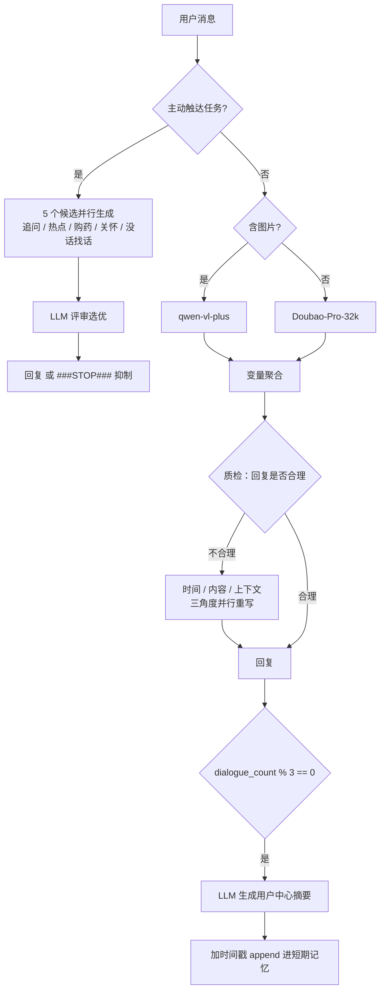

# Agent Lab · Dify Agent 编排实践集

> 8 个可直接导入 Dify 的 Agent / 工作流应用，194 个节点，覆盖 **Agent 范式、多轮状态管理、长短期记忆、RAG、工具调用、结构化输出容错** 六个能力维度。
>
> 实践集。每个案例都写清了**设计取舍**和**已知局限** —— 原型就是原型，不装成产品。
>
> **实测环境**：Dify **1.15.0** + Windows + Docker Desktop。8 个 DSL 全部导入成功并完成发布（7 个带插件依赖警告、1 个完全通过），本地跑通指南见 [`docs/00-local-setup.md`](docs/00-local-setup.md)。

---

## 为什么做这个

Dify 这类低代码平台把 Agent 的门槛降得很低，但真正难的不是拖节点，而是这几个问题：

- 多轮对话里，**状态放哪、怎么不串味**？
- 模型输出不稳定时，**流程凭什么不崩**？
- 什么时候该让 Agent 自主决策，什么时候该用确定性工作流？
- 检索、反思、多候选选优这些"看起来高级"的套路，**代价和收益分别是什么**？

这 8 个应用就是我逐个验证这些问题的过程。其中 NL2SQL 数据分析助手和多轮研究 Agent 是两个相对完整的端到端案例，其余是能力点的最小验证。

## 能力矩阵

| 能力维度 | 对应案例 | 关键实现 |
| --- | --- | --- |
| Agent 自主决策 | `tod-slot-agent` | TOD 策略插件 + 槽位 schema + `conversation_id` 存储 + 完成信号分派 |
| 多轮状态管理 | `deep-researcher` | `dialogue_count` 驱动 4 轮澄清，15 个会话变量跨轮传递 |
| 长短期记忆 | `memory-agent` | 会话变量分长期档案 / 短期记忆，每 3 轮 LLM 摘要压缩后带时间戳追加 |
| 反思与自纠 | `memory-agent`、`web-research-agent` | 质检 LLM 拦截 → 三角度并行重写；4 路并行作答 → LLM 评审选优 |
| RAG | `rag-doc-chat`、`deep-researcher` | 意图门控 → 问题分类路由 → 分路召回；关键词驱动迭代检索 |
| 工具调用 | 6 个案例 | 搜索、爬虫、SQL 执行、时间、ECharts、AWS Lambda 共 9 种工具 |
| 结构化输出容错 | `nlp2sql-analytics-agent`、`code-translator` | JSON/YAML 契约 + 正则抽取 + 缺字段补全 + 解析失败降级 |
| 控制流 | 全部 | 条件分支、迭代、变量聚合、参数提取、模板转换 |
| 模型路由 | 8 个案例 / 11 套配置 | 按任务分配 Claude 3.5、o1-mini、Gemini 2.0、DeepSeek、Qwen-VL、豆包 |

## 三个代表案例

### 1. NL2SQL 数据分析助手 —— 完整链路

自然语言问数据，自动生成 SQL、真实执行、出结论文本并**自动选择合适的图表**。



关键设计：

- **Schema 约束前置**：把表结构、字段含义、输出格式全部写进 system prompt，附带一组 few-shot，要求"每条 SQL 从不同分析维度切入""禁止 `SELECT *`""全量统计必须按学期聚合"。
- **低温度 + 纯 JSON 契约**：`temperature=0.2`，强制输出 ```` ```json ```` 包裹的数组，元素只含 `sql` 字段。
- **双层容错解析**：第一层兼容裸数组 / `{text: ...}` 包装 / markdown 围栏三种形态；第二层对图表 JSON 做字段校验，缺失字段自动补空、解析失败返回默认结构 —— **坏输出不会中断链路**。
- **图表决策交给模型，渲染交给工具**：模型只输出 `chartType / chartTitle / chartData / chartXAxis`，实际渲染由 ECharts 插件的 `line_chart / bar_chart / pie_chart` 完成，职责分离。

📍 详见 [`docs/01-nl2sql.md`](docs/01-nl2sql.md)

### 2. Deep Researcher 多轮研究 Agent —— 状态机 + 多角色

把一句模糊的研究主题，变成一份有结构、有检索支撑的研究报告。



关键设计：

- **澄清靠状态机不靠模型**：`dialogue_count` 0→4 五个分支，每轮只问一个问题，避免"一次抛四个问题"导致用户流失。
- **人设分工对抗同质化**：4 个子主题分别用「严谨详实 / 反共识创新 / 未来推演 / 主动预判」四种系统提示词撰写，同一主题能产出互补视角。
- **关键词驱动检索**：先让模型从每个子主题里抽 2-6 个值得查的关键词，再用 Iteration 逐词检索，比"整段话丢进去检索"召回更准。
- **双源互补**：本地知识库（top_k=6）+ Wikipedia 工具，兼顾领域深度与事实广度和时效。

📍 详见 [`docs/02-deep-researcher.md`](docs/02-deep-researcher.md)

### 3. 健康管家记忆 Agent —— 记忆 + 反思 + 主动触达（原型）



关键设计：

- **两层记忆**：`p_info` 存长期档案（疾病史、用药、生活习惯），`mem` 存短期对话摘要，`task` / `topic` 存运营侧的当周任务与热点话题。
- **按轮次压缩**：每 3 轮触发一次摘要，用「以用户消息为中心，提取需求/偏好/问题」的提示词压缩，再以时间为 key 追加，避免上下文无限膨胀。
- **自检-重写回路**：回复先过质检员，判定不合理时从时间合理性、内容合理性、上下文贴合三个角度并行重写，取其一。
- **主动触达**：用户 2 小时无互动时，并行生成 5 种风格的候选话术，由评审 LLM 挑最合适的一条，可用 `###STOP###` 抑制发送。

> ⚠️ 这是**原型**：记忆的写入链路已通，但主聊天 prompt 尚未回读 `mem`；三处质检提示词仍是占位；「该不该发」是返回常量的桩函数。详见下方局限说明。

📍 详见 [`docs/03-memory-agent.md`](docs/03-memory-agent.md)

## 快速开始

### 1. 准备 Dify

需要 Dify ≥ 1.0（DSL version 0.1.5），本地 Docker 部署即可：

```bash
git clone https://github.com/langgenius/dify.git
cd dify/docker && cp .env.example .env && docker compose up -d
```

### 2. 导入应用

在 Dify 控制台 → 工作室 → 导入 DSL 文件，选择 `apps/` 下的 yml。

### 3. 补齐模型与插件

DSL 里保存的是模型**标识**，不含密钥。导入后需要自行配置对应供应商：

| 应用 | 需要的模型 / 插件 |
| --- | --- |
| `nlp2sql-analytics-agent` | DeepSeek(`deepseek-chat`)、插件 `hjlarry/database`、`langgenius/echarts` |
| `deep-researcher` | Google(`gemini-2.0-flash-exp`)、OpenAI 兼容端点(`deepseek-r1-distill-llama-8b`)、插件 `wikipedia`、一个知识库 |
| `memory-agent` | 通义(`qwen-vl-plus`)、火山(`Doubao-Pro-32k`)、插件 `time` |
| `web-research-agent` | AWS Bedrock(Claude 3.5 Sonnet)、插件 `duckduckgo`、`webscraper` |
| `rag-doc-chat` | DeepSeek(`deepseek-chat`)、一个知识库 |
| `tod-slot-agent` | OpenAI(`o1-mini`)、插件 `svcvit/agent`(TOD 策略) |
| `code-translator` | AWS Bedrock(Claude 3.5 / 3)、插件 `aws/lambda_yaml_to_json` |
| `jieba-tokenizer` | 内置代码沙箱预装 `jieba` |

### 4. 跑通 NL2SQL（需要数据库）

```bash
mysql -u root -p < data/schema.sql
mysql -u root -p < data/seed.sql   # 110 行演示数据
```

然后在 `SQL Execute` 工具节点里填入你的 `db_uri`（形如 `mysql+pymysql://<用户名>:<密码>@<主机>:3306/<库名>`）。
DSL 中该字段刻意留空，**不要把连接串提交进仓库**。

## 目录结构

```
agent-lab/
├── apps/                       # 8 个 Dify DSL 导出文件
│   ├── nlp2sql-analytics-agent.yml
│   ├── deep-researcher.yml
│   ├── memory-agent.yml
│   ├── web-research-agent.yml
│   ├── rag-doc-chat.yml
│   ├── tod-slot-agent.yml
│   ├── code-translator.yml
│   └── jieba-tokenizer.yml
├── docs/
│   ├── 00-local-setup.md       # 本地跑通指南（Windows）
│   ├── 01-nl2sql.md            # 案例详解
│   ├── 02-deep-researcher.md
│   ├── 03-memory-agent.md
│   └── 99-design-notes.md      # 跨案例的设计取舍
├── data/
│   ├── schema.sql              # student_grades 建表
│   └── seed.sql                # 110 行演示数据
├── tools/
│   └── sanitize_dsl.py         # 剔除 DSL 残留空节点的小工具
└── assets/screenshots/         # 运行截图（见该目录 README）
```

## 跨案例的设计取舍

几条踩过坑之后形成的习惯，细节见 [`docs/99-design-notes.md`](docs/99-design-notes.md)：

1. **状态放会话变量，不放 prompt**。prompt 里塞历史会随轮次线性膨胀，且模型会"改写"历史；会话变量是强一致的，还能被人审。
2. **凡是模型输出的结构化数据，后面必须跟一个 Code 节点**。指望模型每次都返回合法 JSON 是不现实的，容错必须写在代码里。
3. **能用确定性分支就别用模型判断**。槽位填满没有、轮次到没到，用 `if-else` 比再问一次模型便宜且可靠。
4. **迭代批处理优于单次长输出**。代码翻译案例里，先出签名再逐函数生成实现，就是为了绕开单次输出长度限制。
5. **每个 LLM 节点都要想好失败路径**。空输出、格式错、超时，三件事至少兜一件。

## 已知局限与后续计划

诚实清单 —— 这些是原型阶段留下的真实问题，不是"未来展望"式客套：

| 问题 | 现状 | 计划 |
| --- | --- | --- |
| 无系统评测 | 全部案例靠人工试跑，没有指标和数据集 | 为 NL2SQL 建 30 题测试集，统计 SQL 执行成功率、结果正确率、图表匹配率 |
| 记忆只写不读 | `memory-agent` 的 `mem` 已写入但主 prompt 未回读 | 补一个"记忆召回"节点，或换向量检索做长期记忆 |
| 占位提示词 | `memory-agent` 三处质检 prompt 为"待更新" | 按时间/内容/上下文三个维度分别补全 |
| 桩函数 | `该不该发` 恒返回 `"1"` | 改为基于最后互动时间 + 免打扰时段判定 |
| SQL 安全 | 直接执行模型生成的 SQL | 生产需只读账号 + 表白名单 + `LIMIT` 兜底 + 拒绝 DDL/DML |
| 无重试 | 单次调用失败即走兜底 | 引入指数退避重试与模型降级链 |

## 说明

- 本仓库只包含**应用编排层**（DSL）与配套的建库脚本、说明文档，**不包含 Dify 源码**。
- 所有 DSL 已清理编辑器残留的空节点（见 `tools/sanitize_dsl.py`，共清理 20 个），语义与原始导出一致。
- 模型密钥、数据库连接串均未写入仓库，导入后需自行配置。
