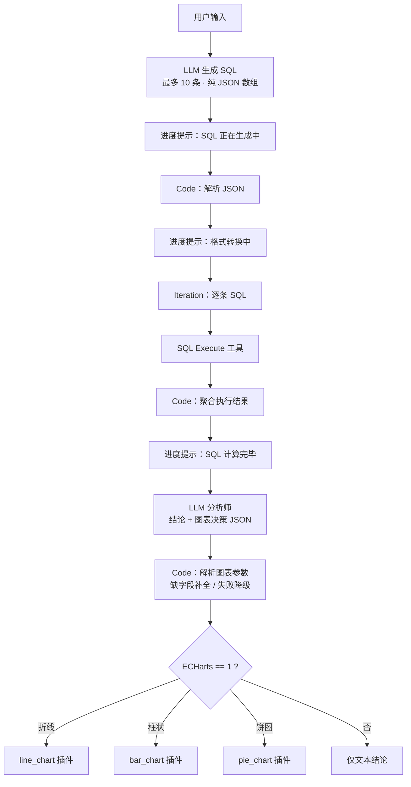

# 案例 01 · NL2SQL 数据分析助手

> `apps/nlp2sql-analytics-agent.yml` · 21 节点 · DeepSeek-chat · MySQL

## 要解决的问题

业务侧想看数据，永远要经过"提需求 → 等排期 → 拿结果"的链路。常见 BI 工具要么要求会拖维度度量，要么要求会写 SQL。这个应用的目标是：**用一句自然语言，直接拿到结论和一张合适的图**。

示例输入（与 DSL 中 few-shot 一致）：

> 查询全校各科目平均分情况

期望输出：一段 Markdown 结论 + 一张按科目分组的图表。

## 链路设计



## 关键设计

### 1. 把约束写死在 system prompt 里

生成 SQL 的提示词做了四件事：

- **给全表结构**：`student_grades` 的 11 个字段逐条说明语义，避免模型猜字段名。
- **限定输出形态**：只能输出 ```` ```json ```` 包裹的数组，元素**仅含 `sql` 字段**，其它话一律不许说。
- **规定分析广度**：最多 10 条，每条从不同维度切入（科目 / 班级 / 学期 / 年级），多维统计要为每个维度单独出子查询。
- **写死性能与规范**：禁止 `SELECT *`、全量查询必须按 `semester` 聚合或排序、要求使用索引字段。

温度设为 `0.2`。SQL 是确定性任务，不需要创造性。

### 2. 结构化输出必须配代码容错

```python
# Code 节点：解析 SQL 候选
try:
    parsed = json.loads(input_string)
    if isinstance(parsed, dict) and "text" in parsed:
        raw_content = parsed["text"]        # 兼容 {text: "..."} 包装
    elif isinstance(parsed, list):
        return {"result": parsed}           # 已经是数组，直接用
except json.JSONDecodeError:
    raw_content = input_string              # 不是 JSON，继续按文本处理

# 兼容 markdown 围栏
m = re.search(r"```json\s*([\s\S]*?)\s*```", raw_content)
json_content = m.group(1).strip() if m else raw_content.strip()
```

这是整个案例里最重要的一段：**模型输出不可信，解析必须假设它会出错**。三种形态都兜住了，后面才有得玩。

图表参数解析同样做了防御 —— 缺 `ECHarts` 字段默认 `"0"`；`ECHarts == "1"` 时缺 `chartType / chartTitle / chartData / chartXAxis` 自动补空串；整体解析失败返回 `default_output` 而不是抛异常。**宁可少画一张图，也不能让整条链路挂掉。**

### 3. 模型决定"画什么图"，插件负责"画出来"

第二个 LLM 的角色是数据分析师，输出一份决策 JSON：

```json
{
  "results": "Markdown 结论",
  "ECHarts": "1",
  "chartType": "柱状图",
  "chartTitle": "各科目平均分对比",
  "chartData": "85.2;88.1;79.4",
  "chartXAxis": "数学;英语;物理"
}
```

提示词里给定了选型规则：**时序趋势 → 折线；类别对比 → 柱状；占比构成 → 饼图（且必须返回百分比）**。条件分支按 `chartType` 路由到 ECharts 插件的三个工具节点。

好处是渲染逻辑完全不用模型操心，换成别的图表库只需要替换工具节点。

### 4. 长链路要给用户反馈

这条链路有 4 次模型/工具串行调用，可能十几秒。所以中间插了 4 个"进度回复"节点：

```
### SQL 正在生成中 → ### 格式转换中 → ### SQL 计算完毕,模型正在汇总中... → 结论
```

Dify 的 `answer` 节点是流式的，这四段文案会依次推给前端，体感上像是"有个东西在干活"，而不是一片空白。**这是纯体验层的设计，但用户感知差异很大。**

## 测试数据

`data/schema.sql` + `data/seed.sql` 建出 `student_grades` 表，**110 行**演示数据，覆盖：

| 维度 | 取值 |
| --- | --- |
| 年级 | 高一 / 高二 / 高三 |
| 班级 | 8 个班（每年级 4 个） |
| 科目 | 数学 / 英语 / 物理 / 化学 / 生物 / 历史 / 地理 / 政治 |
| 学期 | 2023-2024 第一/第二学期、2024-2025 第一学期 |
| 分数区间 | 55 ~ 96（含不及格样本，便于验证及格率口径） |

数据刻意设计成"有低分样本"，否则及格率、优秀率这类查询永远是 100%，验证不出问题。

## 已知局限

1. **没有自纠错回路**。SQL 执行报错时不会把错误信息回灌给模型重写，而是直接走后续流程。生产环境这里应该加一个"执行失败 → 带着 error message 重试一次"的分支。
2. **结果聚合方式粗糙**。循环体结果用 `"".join(str(item) for item in args)` 拼成字符串，行数多时会把上下文撑爆。应该按需截断或先做统计摘要。
3. **SQL 安全未设防**。直接执行模型生成的语句。生产必须：只读账号、表白名单、强制 `LIMIT`、显式拒绝 `INSERT/UPDATE/DELETE/DROP`。
4. **没有评测集**。目前靠人工试跑。要工程化必须建 30 题以上的测试集，统计 SQL 执行成功率 / 结果正确率 / 图表类型匹配率。
5. **单表绑定**。表结构硬编码在 prompt 里，换库要改提示词。更合理的做法是启动时 `information_schema` 自动读取并动态拼装。
