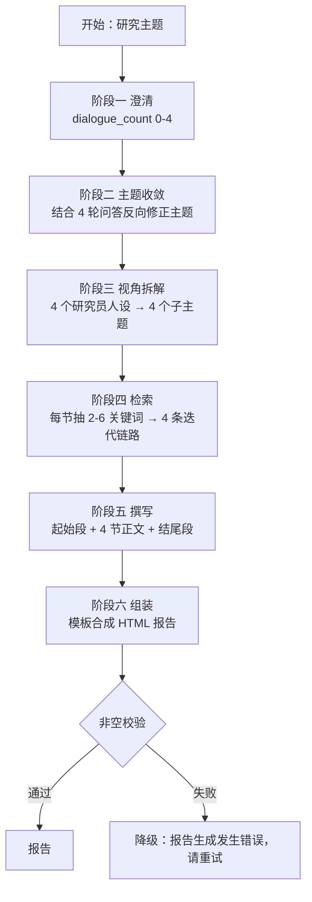

# 案例 02 · Deep Researcher 多轮研究 Agent

> `apps/deep-researcher.yml` · 57 节点 · 15 个会话变量 · Gemini 2.0 / DeepSeek-R1 / Wikipedia / RAG

## 要解决的问题

单轮 RAG 面对一个模糊的研究主题（比如"AI 对教育的影响"）时，几乎必然出问题：

- 检索方向发散，召回一堆不相关的东西；
- 报告结构扁平，四段话就把一个能写五千字的话题讲完了；
- 观点同质化，因为只有一个 system prompt，模型只会在一个视角里打转；
- 容易编，因为没有多源交叉。

这个 Agent 用**多轮澄清 + 多角色分工 + 关键词驱动检索**来解决这四点。

## 六个阶段

### 阶段一：澄清（状态机，不是模型判断）

这是整个应用的核心技巧。用 `sys.dialogue_count` 做轮次分发：

| dialogue_count | 行为 |
| --- | --- |
| 0 | 初始化，把用户输入的 `Research_Theme` 交给问题分解模型 |
| 1 | 输出问题 2，记录问题 1 的回答到 `f1` |
| 2 | 输出问题 3，记录回答到 `f2` |
| 3 | 输出问题 4，记录回答到 `f3` |
| 4 | 收集完毕，进入研究阶段 |

**为什么不交给模型判断"问完了没有"**：模型对"信息是否充分"的判断极不稳定，容易在第 2 轮就自作主张开始写报告。用轮次计数是确定性的，成本为零，行为可预期。

每轮只问一个问题，是因为一次抛四个问题的流失率极高 —— 这属于交互设计上的取舍。

### 阶段二：主题收敛

把原始主题 + 4 轮问答一起喂给模型，要求"在原主题基础上做有限修正，只输出主题本身"。这一步把用户口语化的表述（"想看看 AI 在教育上到底有没有用"）收敛成一个可检索的专业表述（"生成式 AI 在 K-12 教学中的应用效果与局限"）。

### 阶段三：人设分工

四个子主题，四套 system prompt，四种研究风格：

| 角色 | 提示词取向 | 产出特征 |
| --- | --- | --- |
| 严谨型 | 要求详尽、准确、不留歧义 | 事实密度高，适合做基础章节 |
| 反共识型 | 主动挑战主流观点，寻找反例 | 提供批判视角，避免一边倒 |
| 推演型 | 高比例推测，但必须显式标注不确定性 | 提供前瞻判断 |
| 预判型 | 主动预判用户需求与潜在问题 | 提供落地建议 |

同一个模型，换 system prompt 就能拉开观点差异 —— 这比"让模型自己换个角度"有效得多。

### 阶段四：关键词驱动检索

每个子主题不让模型直接开写，而是先过一个 `parameter-extractor`：

> 提取语段中值得查询的 2~6 个关键词（`array[string]` 类型）

然后 `Iteration` 逐词检索。相比"把整段 sub-topic 丢进检索器"，关键词召回的信噪比明显更高。四个子主题各挂一条链路：

- 链路 1-3：本地知识库，`top_k=6`
- 链路 4：Wikipedia 工具（英文），补充通用事实与时效

**双源的意义**：知识库保证领域深度，Wikipedia 保证事实广度。单靠知识库，遇到库里没有的通用概念就会瞎编。

### 阶段五、六：撰写与组装

- `起始段`：要求"只写引言，承上启下第一段，不要输出正文"
- `结尾段`：要求"正文已完成，只做总结，不要重复正文"
- `总结文档`：`template-transform` 节点把 12 个变量拼成带 `<h1> / <h2> / 
` 的 HTML

把"写引言"和"写正文"拆成不同节点，是因为塞在一个 prompt 里模型一定会混着写。

## 会话变量清单

15 个会话变量承载跨轮状态：

| 变量 | 用途 |
| --- | --- |
| `research_theme` | 收敛后的研究主题 |
| `q1` ~ `q4` | 四轮澄清的问题文本 |
| `f1` ~ `f4` | 四轮澄清的用户回答 |
| `query1` ~ `query4` | 回答优化后的版本 |
| `Chat_Stage` | 阶段标记 |
| `Language` | 输出语言 |

两个环境变量 `Generate` / `REASK` 控制流程开关。

## 已知局限

1. **四个子主题是串行跑的**。流程图里 `sub主题1分析 → 2 → 3 → 4` 首尾相接，总延迟是单段的 4 倍。并行分支可以砍掉 75% 的等待时间 —— 这是当前最值得改的一处。
2. **检索结果没有做引用核验**。报告里的论断没有和召回片段一一对应，仍然存在"检索了但没用上"的情况。理想做法是让每个段落输出引用编号，再由代码校验编号有效性。
3. **没有长度控制**。四个子主题各写多长完全由模型自由发挥，最终报告可能 2000 字也可能 8000 字。
4. **失败处理粒度粗**。目前只有一个总兜底（"报告生成发生错误，请重试"），无法定位是哪一阶段失败。
5. **没有评测**。研究报告的质量很难自动评估，目前只能人工看。可考虑用 LLM-as-judge 做结构完整性和引用覆盖率的粗评。
