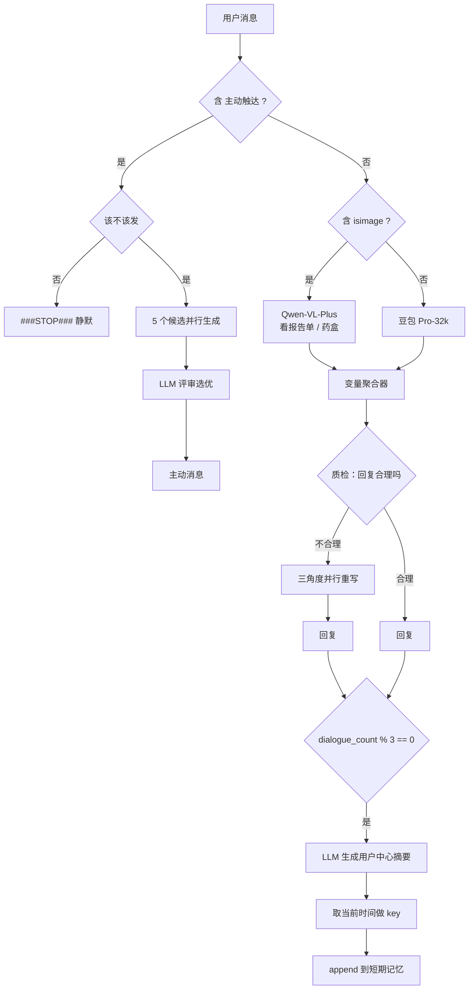

# 案例 03 · 健康管家记忆 Agent（原型）

> `apps/memory-agent.yml` · 37 节点 · 14 个 LLM 节点 · 豆包 Pro-32k / Qwen-VL-Plus

## 要解决的问题

慢病管理场景里，一个"健康管家"需要同时做到：

1. **记得住**：患者三个月前说过对青霉素过敏，今天不能再推荐含青霉素的药。
2. **说得对**：回复不能敷衍，也不能冷冰冰。
3. **找得上话**：患者两天没说话，要能主动、自然地触达，而不是干等。

这三点分别对应**记忆**、**质检**、**主动触达**三套机制。



## 一、记忆：两层结构

| 变量 | 层级 | 内容 | 写入方式 |
| --- | --- | --- | --- |
| `p_info` | 长期档案 | 基本信息、疾病史、用药、生活习惯、注意事项（JSON） | 首轮初始化，`over-write` |
| `mem` | 短期记忆 | 按时间戳累积的对话摘要 | 每 3 轮 `append`，首轮 `clear` |
| `task` | 运营任务 | "周一：提醒用药；周二：健康关爱；周五：实时热点" | 首轮初始化 |
| `topic` | 外部热点 | 当周可聊话题（示例："台风席卷上海"） | 首轮初始化 |

**为什么长期档案用结构化 JSON 而不是向量库**：字段少（几十个）、需要强一致、而且要能人工审阅和修改。这种规模下向量检索是过度设计 —— 召回的不可控性反而会带来风险（漏掉过敏史是医疗事故级别的错误）。等档案涨到上千条非结构化记录，再考虑向量化。

**短期记忆为什么是"摘要"而不是"原文"**：

```python
# 记忆压缩：以用户为中心做摘要
"请根据以下最近的对话内容，生成一个以用户消息为中心的总结。
 重点提取用户的需求、偏好和问题，例如健康咨询、产品偏好等。
 确保总结简洁明了，以便后续使用。"
```

原文累积会让上下文线性膨胀且噪音越来越大。摘要虽然丢信息，但保住了"用户在意什么"这条主线。

压缩由 `dialogue_count % 3 == 0` 触发 —— 每 3 轮一次。这个数字是成本与信息密度的折中：每轮都压太贵且冗余，隔太久又会丢细节。生产环境应该换成**按 token 阈值**或**事件触发**（比如"用户提到新的症状"时才记）。

时间戳由 `time` 插件的 `current_time` 获取，再用一个 Code 节点组织成 `{时间: 摘要}` 的键值结构：

```python
def main(mem, datetime_now):
    return {"result": {f"{datetime_now}": mem}}
```

## 二、质检：自检 → 三角度重写

回复生成后不直接发出，先过一道"聊天内容质检员"：

> 你是一个聊天内容质检员，评价回复内容是否合理。
> 要求：1）文字不超过 50 字；2）上下文不违和；3）患者看到后有回复意愿。

判定"不合理"时，从**三个互补角度**并行重写：

| 节点 | 关注点 |
| --- | --- |
| 时间上的合理性 | 现在这个时间点说这句话是否合适（比如凌晨提醒用药） |
| 内容上的合理性 | 医学表述、剂量、禁忌是否有问题 |
| 上下文的内容 | 是否接得上上一轮对话，有没有答非所问 |

三路结果里取一条作为最终回复。

这是典型的 **reflexion 模式**：生成 → 评估 → 修正。区别在于评估标准被拆成了三个正交维度，比"你检查一下有没有问题"这种笼统指令有效得多。

## 三、主动触达：五候选 + 评审

当输入带 `主动触达` 标记（由定时任务注入），走另一条链路。核心是**不要只生成一条**：

| 候选 | 触发条件 | 提示词意图 |
| --- | --- | --- |
| 追问 | 上次话题中断 | "根据聊天记录和记忆追问用户" |
| 找热点话题 | 有当周热点 | 从 `<topic>` 标签的话题里选合适的切入 |
| 购药任务 | 用药周期到了 | 提醒及时购药 |
| 近期关怀 | 天气/节气变化 | 主动关怀 |
| 没话找话 | 兜底 | 二次互动，维持关系 |

五条并行生成，再由 `综合评价` 节点做评审：

> 你是聊天内容质检员，从 `<reply>` 里的候选内容中挑选最合适的一条进行回复。

**为什么是"生成多候选再评审"而不是"一次生成最优"**：单次采样方差大，一次生成的话术经常踩雷（太推销、太机械、时间不合适）。best-of-5 + judge 把稳定性提上来了，代价是 5 倍 token 成本 —— 但这个链路一天只跑几次，成本可以接受。

评审后可以输出 `###STOP###` 表示"这轮不发"，避免为了触达而触达。

## 四、多模态分流

`isimage` 标记决定走哪条：

- 图片 → `Qwen-VL-Plus`（看化验单、药盒）
- 文本 → `豆包 Pro-32k`（中文医疗语料更顺）

两条结果汇入变量聚合器，后续质检逻辑复用，不用写两遍。

## 已知局限（重要）

这个案例是**原型**，以下问题真实存在，不要当成成品：

1. **记忆只写不读**。`mem` 每 3 轮写入了，但主聊天流程的 prompt 里并没有回读 `mem` 和 `p_info`。写入链路通了，读取链路没接 —— 这是最需要补的一环。
2. **三处质检提示词是占位**。`时间上的合理性` / `内容上的合理性` / `上下文的内容` 三个节点的 system prompt 都还是"提示词待更新"，实际跑起来三路输出会和主流程雷同。
3. **`该不该发` 是桩函数**，恒返回 `"1"`，等于默认永远发送。应该基于"最后互动时间 + 免打扰时段 + 当日触达次数"判定。
4. **记忆没有遗忘机制**。只 append 不淘汰，跑几百轮后 `mem` 会变得很长。
5. **医疗合规未处理**。虽然每个 prompt 都加了"仅供参考"的免责声明，但剂量、禁忌这类高风险内容的护栏远不够，真实产品需要独立的规则引擎。
